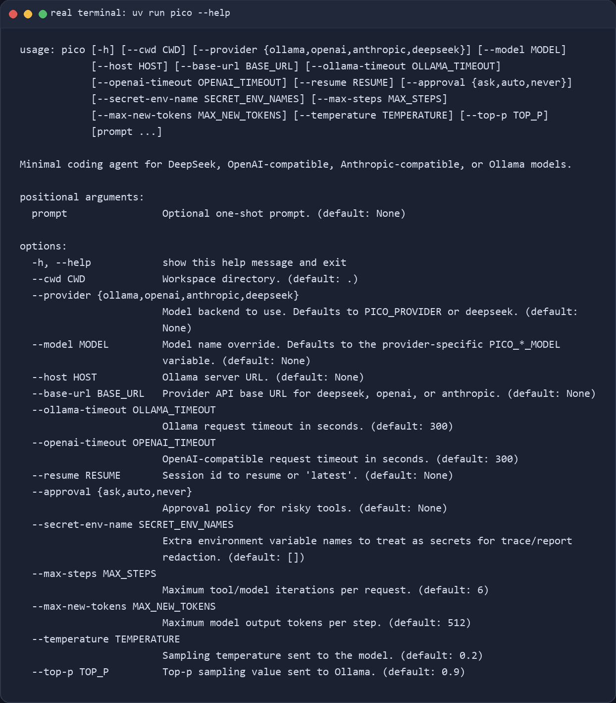
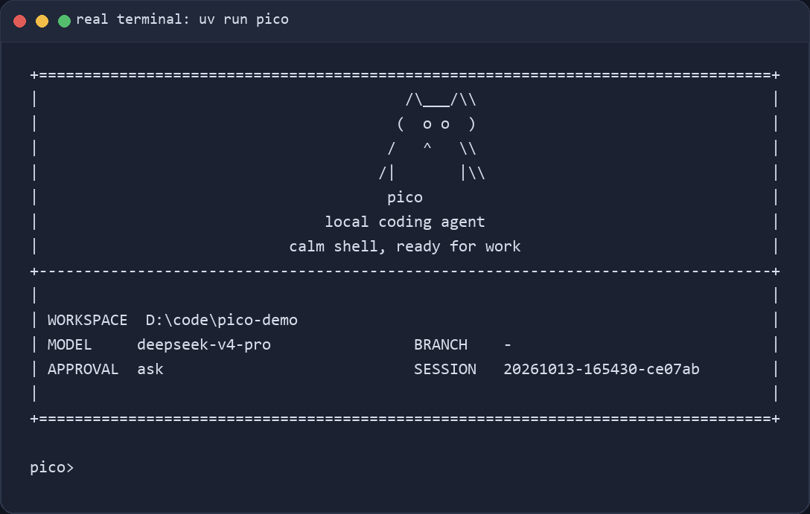
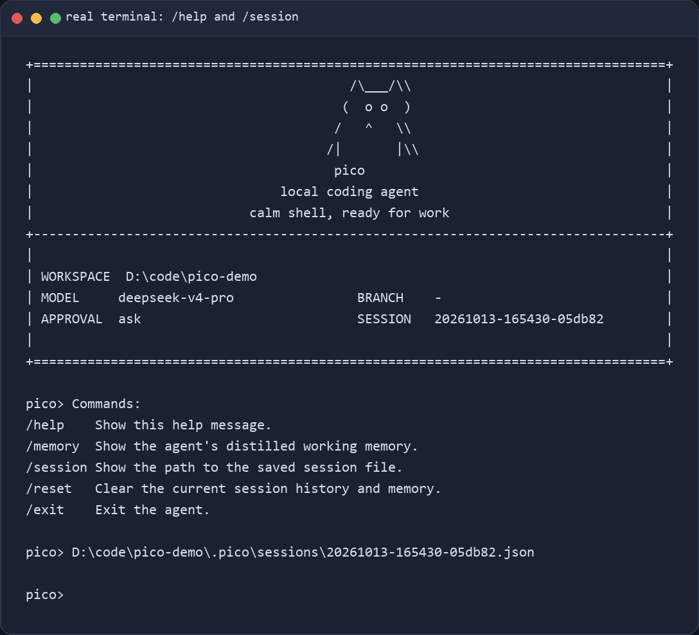
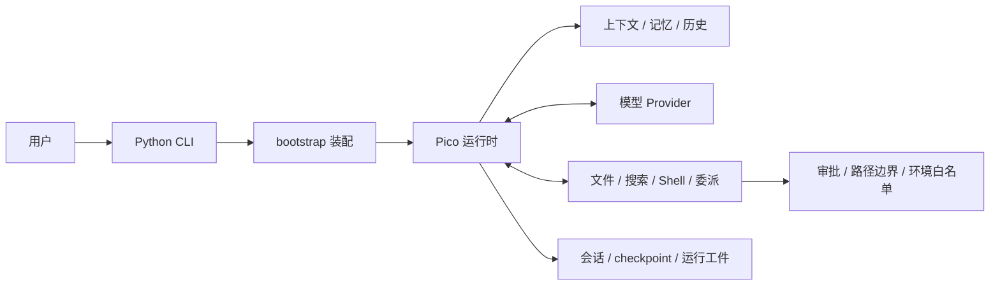

# pico

面向本地代码仓库的 Python 命令行 Agent。它连接大模型、读取工作区事实、按预算组装上下文并执行受约束的工具，把会话与运行工件留在本地 `.pico/` 目录里，可恢复也可复盘。

你可以在一个真实仓库里让它排查测试失败、分析调用链或完成一次小步迭代。它更像能在仓库里持续工作的命令行助手，不是纯聊天窗口：所有入口共用同一套控制循环与工具执行机制。

## 核心能力

- 通过 CLI 接收任务，支持单次请求、持续对话和会话恢复。
- 连接四类模型后端：DeepSeek、OpenAI 兼容端点、Anthropic 兼容端点和本地 Ollama。
- 执行文件读写、精确替换、内容搜索和 Shell 命令，把工具结果送回模型继续处理。
- 按上下文预算组装稳定指令、工作记忆、相关笔记与历史，控制单次请求的迭代上限。
- 用工作区快照和文件差异回答“这次调用改了什么”，而不是采信模型的说法。
- 通过审批策略、Workspace 路径锚定、Shell 环境白名单和工件脱敏守住执行边界。
- 保存会话、checkpoint 与运行工件，提供可复现的固定 benchmark 与消融实验。
- 把用户明确要求沉淀的结论写入跨会话长期记忆，其余内容留在会话内。

运行时零第三方依赖：模型协议走标准库，渲染走文本排版，持久化走 `json`。

## 使用截图

CLI 帮助信息：



启动界面：



REPL 内置命令与会话路径：



## 系统架构



| 能力 | 所有者 | 说明 |
| --- | --- | --- |
| 参数解析、交互循环与终端渲染 | `interfaces` | 把用户输入翻译成装配参数 |
| 快照采集、Provider 创建与装配 | `bootstrap` | 唯一知道全部具体实现的位置 |
| 控制循环、上下文、会话与子 Agent | `runtime` | 统一执行机制与状态维护 |
| 工具目录、执行护栏与记忆 | `capabilities` | 提供能力与协议 |
| 模型协议适配 | `integrations` | 屏蔽 transport 差异 |
| 审批、路径与脱敏 | `security` | 判断操作是否允许 |
| 运行工件与报告 | `observability` | 记录运行事实 |
| 固定评测与实验指标 | `extensions` | 观察并复现运行，不改变行为 |

## Agent 请求流程

```text
用户输入
  -> 采集工作区快照并加载项目配置
  -> 选择 Provider、新建或恢复会话
  -> 组装指令、记忆、相关笔记、历史与本轮请求
  -> 调用模型，解析工具调用或最终答案
  -> 通过执行护栏运行工具，结果写回历史
  -> 继续迭代，或被取消、达到执行限制
  -> 保存会话、记录 checkpoint 与工件，返回答案
```

一次请求可以包含多次模型调用。工具预算与请求次数上限分开统计：模型格式错误的输出消耗请求次数，但不消耗工具预算。

## 技术栈

| 分类 | 技术 |
| --- | --- |
| Python 运行时 | Python 3.12、标准库、dataclass、`typing.Protocol` |
| 模型接入 | `urllib` 直连 Anthropic/OpenAI 兼容端点、Ollama |
| 上下文管理 | 分段预算、历史压缩与摘要、prompt 缓存键 |
| 状态与持久化 | 会话 JSON、checkpoint、原子写、JSON Lines Trace |
| 执行环境 | 主机 Shell、过滤后的环境变量白名单 |
| 评测 | 固定任务卡、脚本模型、消融与聚合指标 |
| 测试与质量 | Pytest、Ruff、pre-commit、GitHub Actions |
| 依赖与构建 | uv、Hatchling |

## 项目结构

```text
pico/
|-- src/pico/                # Python 产品代码
|   |-- interfaces/          # CLI、REPL 与终端渲染
|   |-- bootstrap/           # 服务与 Provider 装配
|   |-- runtime/             # Agent、上下文、会话、子 Agent 和工作区
|   |-- capabilities/        # 工具与记忆
|   |-- integrations/        # 模型 Provider
|   |-- config/              # 配置模型、加载和状态路径
|   |-- contracts/           # 请求状态、消息与事件
|   |-- observability/       # 运行工件与报告
|   |-- security/            # 审批、路径边界和脱敏
|   |-- extensions/          # 评测与实验指标
|   `-- shared/              # 时钟、文本、路径和原子 IO
|-- tests/                   # 单元、契约、集成和工程测试
|-- benchmarks/              # 评测任务输入与冻结结果摘要
|-- scripts/                 # CI 门禁与开发入口
|-- examples/                # mini-pico 教学实现
|-- docs/                    # 安装、使用、配置、架构、测试和排障
`-- .github/                 # CI 与 Issue、PR 模板
```

`.venv`、缓存、`.env` 和 `.pico` 属于本地环境或运行数据，不进入 Git 仓库。

## 环境要求

- Python 3.12
- uv 与 Git，供源码安装和开发使用
- 可用的模型服务及对应凭证，或本地 Ollama

基础使用不需要数据库、消息队列或额外的 Node.js 环境。

## 快速开始

### 1. 安装依赖

```powershell
uv sync
uv run pre-commit install
uv run pre-commit install --hook-type commit-msg
```

### 2. 配置模型

```powershell
Copy-Item .env.example .env
```

然后填入要使用的 provider key。常规情况下只填一把就够：

```text
PICO_DEEPSEEK_API_KEY="your-api-key"
```

`.env` 已被 Git 忽略，不要提交真实 key。DeepSeek 走 Anthropic 兼容端点，默认模型与地址由代码给出，临时切换不必改文件：

```powershell
uv run pico --model deepseek-v4-pro --base-url https://api.deepseek.com/anthropic
```

### 3. 启动助手

在当前仓库进入交互模式：

```powershell
uv run pico
```

在别的目录工作：

```powershell
uv run pico --cwd /path/to/repo
```

执行单次任务：

```powershell
uv run pico "inspect the test failures and propose a fix"
```

源码树里也可以用 `python -m pico`，与 `pico` 命令调用同一个入口。

首屏会同时确认工作区、分支、审批策略和会话 ID：

```text
pico>
```

## 运行入口

| 入口 | 命令 | 用途 |
| --- | --- | --- |
| 交互模式 | `uv run pico` | 持续对话，历史与记忆跨轮延续 |
| 单次任务 | `uv run pico "..."` | 脚本调用，失败返回退出码 1 |
| 会话恢复 | `uv run pico --resume latest` | 继续最近修改的会话 |
| 指定会话 | `uv run pico --resume <session-id>` | 回到某一次工作现场 |
| 只读调查 | `uv run pico --approval never` | 允许读取与搜索，拒绝所有写入 |
| 无审批 | `uv run pico --approval auto` | 高风险动作直接执行 |

内置命令：`/help` 查看命令、`/memory` 查看工作记忆、`/session` 打印会话文件路径、`/reset` 清空历史与记忆、`/exit` 退出。

## 模型后端

配置优先级是：

```text
显式 CLI 参数 > .env 里的 PICO_* 变量 > 旧环境变量 > 代码默认值
```

Provider 选择不传参数时的顺序是 `--provider > PICO_PROVIDER > deepseek`。默认选择 DeepSeek：它的 Anthropic 兼容端点比本地 Ollama 更少依赖本机模型环境，也比 OpenAI/Anthropic 兼容代理少一层默认 gateway 假设。

| provider | 默认端点 | API key 变量 | 默认模型 |
| --- | --- | --- | --- |
| `deepseek` | `https://api.deepseek.com/anthropic` | `PICO_DEEPSEEK_API_KEY` | `deepseek-v4-pro` |
| `openai` | `https://www.right.codes/codex/v1` | `PICO_OPENAI_API_KEY` | `gpt-5.4` |
| `anthropic` | `https://www.right.codes/claude/v1` | `PICO_ANTHROPIC_API_KEY` | `claude-sonnet-4-6` |
| `ollama` | `http://127.0.0.1:11434` | 不需要 | `qwen3.5:4b` |

如果 right.codes 给你的是一把共享 key，只填 `PICO_RIGHT_CODES_API_KEY` 即可，两个兼容端点都会回退到它。`.env` 解析器只读取字面量，不展开变量引用。

Pico 使用文本编码的工具协议，因此会在 DeepSeek 请求中显式关闭 provider-native thinking，避免思考内容耗尽单步输出预算或产生无法回放的 thinking block。后续接入原生工具协议时，需要同时实现 thinking block 的完整回放，不能只删除这个开关。

完整变量、回退顺序和取值影响见[配置参考](docs/reference/configuration.md)。

## 测试

```powershell
uv run ruff check src scripts tests examples
uv run ruff format --check src scripts tests examples
uv run python -m scripts.ci.check_architecture
uv run pytest tests -n 4 -q --strict-markers
```

支持 Make 的环境用 `make check` 执行完整本地门禁。默认回归不连接真实模型；真实请求、外部程序与计时实验通过 marker 显式选择，见[测试指南](docs/development/testing.md)。

## 运行与安全说明

- 模型请求可能产生费用；凭证只从环境变量与 `.env` 读取，不接受命令行参数。
- 文件工具被锚定在工作区根之内，`..` 与符号链接解析后越界会被拒绝。
- `run_shell`、`write_file` 和 `patch_file` 属于高风险动作，受审批策略控制，执行环境只带白名单变量。
- 会话、Trace 与报告默认只写在本地 `.pico/`，写入前对已识别的凭证做替换；识别范围是环境变量值形态。
- 个人会话、原始评测输出和密钥不提交到 Git。

## 更多文档

- [安装与首次运行](docs/getting-started/installation.md)
- [使用指南](docs/guides/usage.md)
- [配置参考](docs/reference/configuration.md)
- [架构与代码归属](docs/architecture/overview.md)
- [测试指南](docs/development/testing.md)
- [故障排查](docs/guides/troubleshooting.md)
- [Benchmark 使用说明](benchmarks/README.md)
- [贡献指南](CONTRIBUTING.md)
