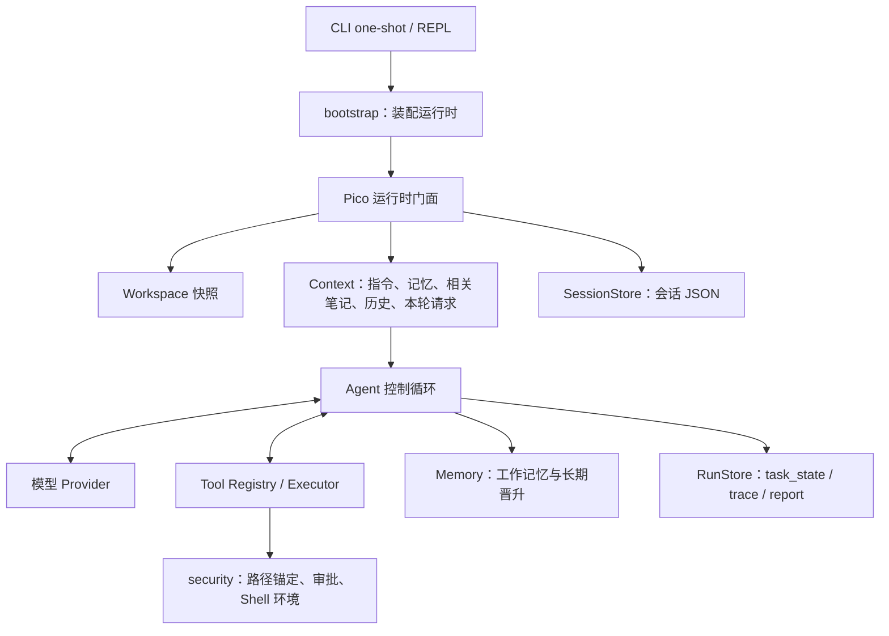

# 架构与代码归属

Pico 在本地仓库里把一个模型扩展成可以持续工作的 Agent：读取工作区事实、按预算组装上下文、请求模型、执行模型提出的工具、把结果回灌继续下一轮，并把会话与运行工件留在本地。所有入口共用同一套执行机制，终端是当前唯一的入口。

## 系统架构



## 模块职责

| 模块 | 负责内容 | 主要边界 |
| --- | --- | --- |
| `interfaces` | 参数解析、交互循环与终端渲染 | 只翻译输入输出，不实现 agent 语义 |
| `bootstrap` | 采集快照、加载配置、创建 Provider、装配运行时 | 唯一知道全部具体实现的位置 |
| `contracts` | 请求状态、消息形状与运行事件 | 不依赖入口、装配层或外部 SDK |
| `runtime` | 控制循环、上下文组装、会话持久化、子 Agent 与工作区事实 | 维护一次请求的执行与状态 |
| `capabilities` | 工具目录与执行护栏、工作记忆与长期记忆 | 提供能力和协议，不决定停机 |
| `integrations` | 模型 Provider transport 适配 | 屏蔽协议差异，不理解任务语义 |
| `observability` | 运行工件与报告 | 记录运行事实，不解释结果 |
| `security` | 路径边界、审批策略、环境变量与工件脱敏 | 判断操作是否允许 |
| `extensions` | 固定 benchmark 与实验指标 | 只观察和复现运行，不改变运行时行为 |
| `config` | 配置加载、Provider 目录、状态路径与运行默认值 | 描述取值，不创建运行对象 |
| `shared` | 时钟、文本裁剪、路径与原子 IO | 不依赖其他职责组 |

## 仓库结构

```text
pico/
├── src/pico/                 # Python 产品代码
│   ├── bootstrap/           # 服务装配与 Provider 创建
│   ├── config/              # 配置加载、Provider 目录、路径与 models/
│   ├── contracts/           # 请求状态、消息与运行事件
│   ├── interfaces/          # cli/、rendering/
│   ├── runtime/             # agent/、context/、sessions/、subagents/、workspace/
│   ├── capabilities/        # tools/、memory/
│   ├── integrations/        # llm/
│   ├── observability/       # runs/
│   ├── security/            # authorization/、redaction
│   ├── extensions/          # evaluation/
│   └── shared/              # 时钟、文本、路径和原子 IO
├── tests/                   # unit/、contracts/、integration/、tooling/、fixtures/
├── benchmarks/              # 评测任务输入与冻结结果摘要
├── scripts/                 # ci/、dev/
├── examples/                # mini-pico 教学实现与示例配置
├── docs/                    # 安装、使用、配置、架构、测试和排障
├── assets/                  # README 使用的截图
└── .github/                 # CI 与 Issue、PR 模板
```

虚拟环境、缓存、`.env` 和 `.pico/` 运行数据由 Git 忽略。Prompt 模板文本随所属模块存放，评测任务卡留在 `benchmarks/`。

## Agent 请求流程

```text
入口创建装配参数
  -> 采集工作区快照并加载项目配置
  -> 选择 Provider 并创建模型客户端
  -> 新建或恢复会话
  -> 组装上下文并调用模型
  -> 解析输出：工具调用、重试提示或最终答案
  -> 通过执行护栏运行工具，结果写回历史
  -> 继续迭代，或达到执行限制
  -> 保存会话、记录 checkpoint 与工件，返回答案
```

对应源码：

1. `interfaces/cli/app.py` 解析参数，`bootstrap/container.py` 采集 `WorkspaceContext`、加载 `.env`、创建 SessionStore 与模型客户端。
2. `runtime/agent/agent.py` 构造一次运行的现场：工具目录、上下文组装器、记忆对象、恢复状态，并立刻保存会话文件。
3. `runtime/agent/loop.py` 每轮先调用 `runtime/context/assembler.py` 组装 Prompt，再向 `integrations/llm` 请求一次输出。
4. `runtime/agent/prompts.py` 把模型文本解析成工具调用、重试提示或最终答案。
5. 工具调用交给 `capabilities/tools/executor.py`：允许名单、参数校验、重复调用、审批、执行、结果裁剪与工作区差异，是否放行由 `security/authorization` 判断。
6. 执行结果写回会话历史，同时更新 `capabilities/memory` 的工作记忆，并记录 checkpoint 与 Trace 事件。
7. 预算耗尽时循环会再请求一次并要求只给结论；终态由 `contracts/turns.py` 的 `TaskState` 记录，`observability/runs` 写出报告。

一次请求可以包含多次模型调用。工具预算与请求次数上限分开统计：格式错误的输出消耗请求次数，不消耗工具预算。

## 文件与函数归属

以下路径均相对于 `src/pico`：

| 职责 | 所属位置 |
| --- | --- |
| 参数解析、交互循环、首屏渲染 | `interfaces/cli` |
| 工作区快照采集与差异比较 | `runtime/workspace` |
| Provider 创建与配置优先级 | `bootstrap/providers.py` |
| 运行时装配 | `bootstrap/container.py` |
| 请求状态、消息形状与事件名 | `contracts` |
| 模型与工具迭代 | `runtime/agent/loop.py` |
| 运行现场与能力持有 | `runtime/agent/agent.py` |
| 模型输出解析 | `runtime/agent/prompts.py` |
| checkpoint 与恢复状态 | `runtime/agent/checkpoints.py` |
| 上下文预算、分段渲染与历史压缩 | `runtime/context` |
| 稳定 Prompt 前缀与工具签名 | `runtime/context/instructions` |
| 会话结构、读写与恢复 | `runtime/sessions` |
| 子 Agent 的创建与约束 | `runtime/subagents` |
| 工具定义、注册与执行护栏 | `capabilities/tools` |
| 工作记忆、检索与长期晋升 | `capabilities/memory` |
| 模型协议适配 | `integrations/llm` |
| 运行工件与报告 | `observability/runs` |
| 脱敏、路径锚定、审批策略与 Shell 环境 | `security` |
| 固定 benchmark、消融与指标聚合 | `extensions/evaluation` |
| 配置模型、状态路径与运行默认值 | `config` |
| 时钟、文本裁剪、原子写与路径工具 | `shared` |

函数首先放在业务所属模块。私有辅助函数与调用方放在一起，只有多个调用方确实需要相同语义时才提取。文件按职责命名，避免堆积宽泛的工具函数集合。

Python 模块和函数使用 `snake_case`，类使用 `PascalCase`，内部符号以 `_` 开头。跨模块的消息约定放入 `contracts`，仅用于类型提示的依赖放在 `TYPE_CHECKING` 分支里。

## 依赖边界

- `contracts` 与 `shared` 不导入其他职责组，也不依赖入口或 SDK。
- `config` 只描述取值与路径，不创建 Provider，也不装配运行时。
- `runtime`、`capabilities`、`integrations`、`observability`、`security`、`extensions` 不导入 `interfaces` 或 `bootstrap`；各入口复用同一执行机制。
- `bootstrap` 可以知道所有具体实现，产品代码不反向依赖它。
- 产品源码不直接依赖 `tests`、`scripts` 或 `benchmarks`。
- 旧的扁平入口 `pico.evaluator`、`pico.metrics`、`pico.models`、`pico.memory` 已退役，不再作为 import 路径保留。

架构检查通过 `uv run python -m scripts.ci.check_architecture` 执行，它按 AST 检查静态导入边界，包含函数内的运行时导入。

## 源码阅读入口

| 关注点 | 文件 |
| --- | --- |
| 参数解析与运行方式分派 | [app.py](../../src/pico/interfaces/cli/app.py) |
| 运行时装配 | [container.py](../../src/pico/bootstrap/container.py) |
| 一次运行的现场 | [agent.py](../../src/pico/runtime/agent/agent.py) |
| 模型与工具循环 | [loop.py](../../src/pico/runtime/agent/loop.py) |
| 上下文组装 | [assembler.py](../../src/pico/runtime/context/assembler.py) |
| 工具执行护栏 | [executor.py](../../src/pico/capabilities/tools/executor.py) |

先沿一条请求理解调用关系，再阅读具体工具或外部适配器。测试与边界验证见[测试指南](../development/testing.md)。
