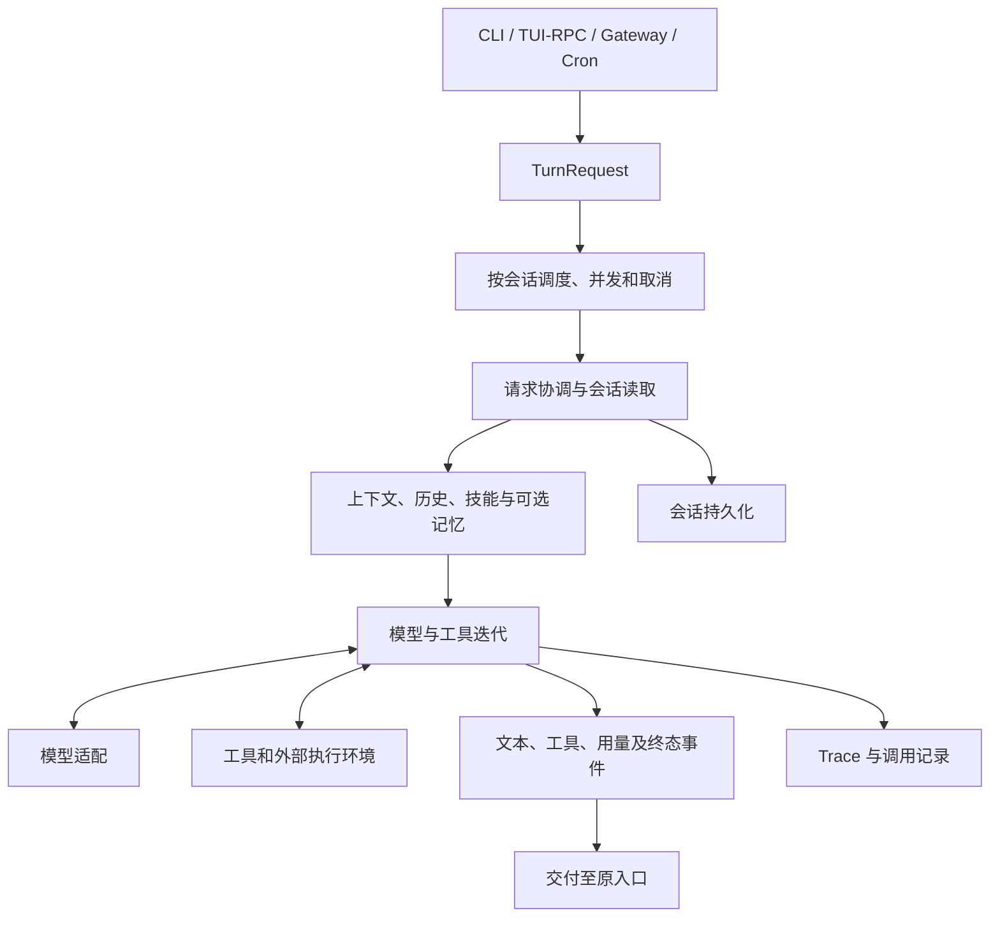

# 项目结构与执行原理

Pico 是共享 Python 执行内核的多入口助手。CLI、RPC、消息渠道与 Cron 统一形成请求，由运行时负责调度、模型/工具执行、会话和交付。React + TypeScript 分别通过 Ink 和 React DOM 展示终端与 Trace 页面。

## 术语对照

| 术语 | 在 Pico 中的含义 |
| --- | --- |
| CLI / TUI | 命令行调用 / 可交互的终端界面 |
| RPC | TUI 与 Python 宿主之间的本机过程调用协议 |
| Gateway | 持续连接消息渠道、接收任务并交付结果的宿主 |
| Provider | 将统一模型调用适配到具体供应商或兼容端点 |
| Session / Turn | 一段持续会话 / 其中一次用户或自动任务请求 |
| Trace / Span | 执行链记录 / 链中的一次具体操作记录 |
| Skill / Plugin / MCP | 工作说明与上下文 / 宿主内代码扩展 / 外部工具服务协议 |
| wheel / sdist / extra | Python 安装制品 / 源码发行包 / 可选依赖集合 |
| PTY | 用于真实终端输入输出的伪终端接口 |

## 仓库地图

```text
pico-harness/
├── src/pico/               Python 产品包
│   ├── interfaces/         CLI、RPC、Gateway 输入输出
│   ├── application/        实际跨入口用例，目前为会话导出
│   ├── bootstrap/          配置驱动的 Provider、插件、宿主装配
│   ├── contracts/          请求、消息与运行事件
│   ├── runtime/            执行、上下文、调度、会话、交付与生命周期
│   ├── capabilities/       工具、技能、记忆与自动化
│   ├── integrations/       模型、渠道、MCP、执行器、插件适配
│   ├── config/             配置模型、加载与路径
│   ├── observability/      Trace、用量和成本
│   ├── security/           授权与权限判断
│   ├── extensions/         运行时评估及独立改进实验
│   ├── resources/          内置技能、模板和打包资源定位
│   └── shared/             基础 IO、锁、路径和算法
├── apps/tui/               React + TS + Ink
├── apps/tracing-viewer/    React DOM + TS 页面、Node TS 服务
├── contracts/              OpenRPC 与 Trace API JSON Schema
├── packages/contracts/     生成 TS 类型和内嵌响应校验器
├── tests/                  Python 单元、契约、集成及工程测试
├── scripts/                ci、dev、release、install 工具
├── benchmarks/             可复现评测与任务输入
├── examples/               可提交的脱敏示例
├── docs/                   中文使用、开发、参考和运维手册
└── LICENSES/               随分发依赖的许可证原文
```

## 为什么使用 src/pico

仓库名、发行名 `pico-harness` 与 Python 导入名 `pico` 不必相同。`src/pico` 将产品代码与测试、脚本、文档分开，避免当前目录意外遮蔽安装包，也便于验证 wheel 的真实资源。开发用 `uv run` 或已安装包加载代码，独立验收在仓库外执行，不能只靠工作区路径恰好存在。

## 一次请求怎样执行



1. 入口建立 `TurnRequest`，包含来源、会话和忙时策略。
2. `runtime/scheduling` 为同一会话串行处理请求，控制跨会话并发和取消；当前工作可在迭代边界接收注入。
3. `runtime/agent/turn_runner.py` 协调会话和入站逻辑，`runtime/context/assembler.py` 组装预算内的模型输入。
4. `runtime/agent/execution.py` 调用模型并执行工具，工具结果回到消息后继续迭代；`streaming.py` 处理流式文本和参数。
5. 运行时保存会话、产生终态，Delivery 按来源交付结果。Trace 和用量记录用于观察执行过程。

## 依赖与生命周期边界

| 所属层 | 约束 |
| --- | --- |
| `contracts` | 只定义约定，不依赖入口、装配或 SDK |
| `application` | 协调实际共享用例，不依赖入口和装配，不另建执行器 |
| `runtime` | 拥有调度、取消、会话锁、代际与执行资源，不反向依赖应用用例、CLI、RPC、装配 |
| `capabilities`、`integrations`、`observability` | 不依赖具体用户入口；协议留在所属能力，SDK 适配留在集成层 |
| `bootstrap` | 选择实现、创建宿主，具体机制仍由所属服务维护 |
| `shared` | 不依赖其他 Pico 职责组 |

产品源码不导入 `tests`、`scripts`、`benchmarks`。只用于类型的依赖放在 `TYPE_CHECKING`。不创建空的 turns/configuration/storage 层；已有运行时机制具有明确所有者时不重复包装。

Gateway 在正在运行的事件循环内装配调度与渠道出口。关闭按健康监听、Cron、交互问题、渠道入站、调度/交付、渠道传输、Agent 和运行资源依次尝试清理；运行失败优先保留。Ctrl+C 由 asyncio 管理，SIGTERM 和 Windows SIGBREAK 通过取消运行任务进入同一清理链，重复 SIGTERM/SIGBREAK 不打断正在进行的清理。

## 两种前端怎样组织

| 位置 | 责任 |
| --- | --- |
| `apps/tui/src/app` | 根布局、应用装配与协调 |
| TUI `features` | 对话、会话、模型、委派、交互和命令 |
| TUI `platform`、`rpc` | 终端/系统适配、协议传输与订阅 |
| TUI `ui`、`shared` | 基础展示、主题及纯逻辑，不反向依赖功能编排 |
| Trace `src/web` | `app/api/features/ui/shared`；请求、展示与交互 |
| Trace `src/server` | `config/http/tracing`；日志投影、查询与资源访问 |

TUI 和浏览器共享 React + TS 工具链及契约，各自使用 Ink 和 DOM，不强制共享组件。Trace 保留 health、shutdown、descriptors、search、data、artifact 六类 API，包括 ETag/304、路径约束与受保护停止。富详情格式化为受限 React 节点；原始跨框架 JSON 保留开放边界，规范化后的 API 与展示模型使用明确类型。

## 契约、构建和资源

根 `contracts/rpc/openrpc.json` 定义 RPC，`contracts/tracing/api.schema.json` 定义规范化 Trace 响应。`packages/contracts` 提供生成类型和内嵌 AJV 校验器，运行包不需要读取仓库 Schema。协议变更见[扩展开发](扩展开发.md)。

根 npm workspaces 与单一锁文件管理两应用、契约包和 Hermes Ink。wheel 只携带生产 bundle、页面资产、描述符及 Python 资源；sdist 同时带 TS 源码、根配置、Schema 和预构建资源，从 sdist 重建 wheel 不要求安装前端工具。发行门禁见[运行与发布](../运维/运行与发布.md)。

## 阅读源码的入口

| 关注点 | 文件 |
| --- | --- |
| 命令与默认 TUI | [app.py](../../src/pico/interfaces/cli/app.py) |
| 宿主与插件装配 | [container.py](../../src/pico/bootstrap/container.py) |
| 调度 | [scheduler.py](../../src/pico/runtime/scheduling/scheduler.py) |
| 请求协调 | [turn_runner.py](../../src/pico/runtime/agent/turn_runner.py) |
| 上下文 | [assembler.py](../../src/pico/runtime/context/assembler.py) |
| 模型/工具执行 | [execution.py](../../src/pico/runtime/agent/execution.py) |
| 会话导出用例 | [sessions.py](../../src/pico/application/sessions.py) |

状态位置与文件生命周期见[配置与状态](../参考/配置与状态.md)；静态边界检查及测试见[测试说明](测试说明.md)。
